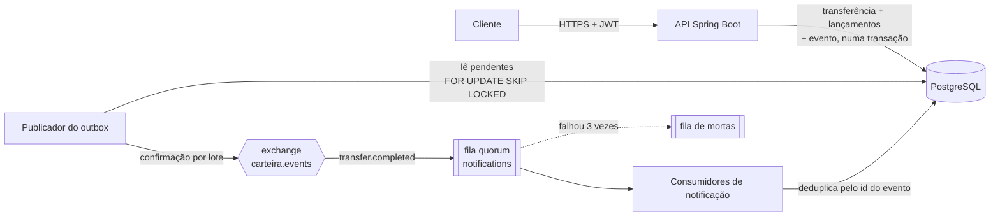
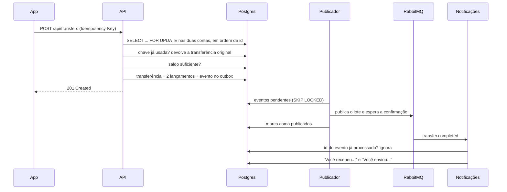
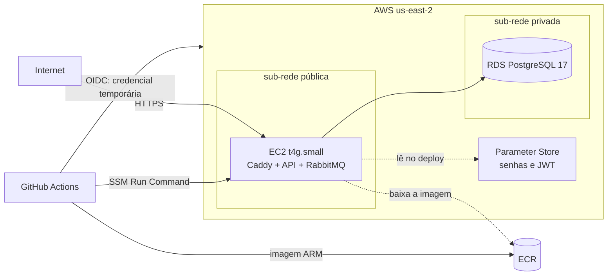

# Carteira

[](https://github.com/guialmm/carteira/actions/workflows/ci.yml)
[](https://github.com/guialmm/carteira/actions/workflows/deploy.yml)

**[API no ar, com Swagger → 3-128-146-167.sslip.io/docs](https://3-128-146-167.sslip.io/docs)** — crie uma conta em
`/api/auth/register`, entre em `/api/auth/login`, clique em **Authorize** e cole o token. O
depósito de demonstração coloca até R$ 1.000,00 de dinheiro fictício na conta.

API de uma carteira digital com **transferências estilo Pix**: conta, depósito, transferência
por conta ou por chave Pix, extrato e notificações. O saldo vem de um **livro-razão de partidas
dobradas**, as transferências são **idempotentes** e continuam corretas com **centenas de
pedidos simultâneos na mesma conta**, e os eventos saem para o **RabbitMQ por um outbox
transacional**.

Java 25 + Spring Boot 4 + PostgreSQL + RabbitMQ. Testes com JUnit 5 e Testcontainers (bancos
e filas de verdade, sem mocks), teste de carga com k6, CI no GitHub Actions e deploy na AWS
(EC2, RDS, ECR) com a infraestrutura toda em Terraform.

## Contexto

Mover dinheiro entre duas linhas de uma tabela parece fácil. O que separa uma carteira de
verdade de um CRUD são os casos que só aparecem com tráfego real:

- **Gastar o mesmo real duas vezes.** Duas transferências leem o saldo de R$ 100 ao mesmo
  tempo, as duas acham que podem sair e a conta termina negativa.
- **Cobrar duas vezes no retry.** O app manda a transferência, a resposta se perde no 4G, o app
  tenta de novo. Sem idempotência, o cliente paga duas vezes.
- **Deadlock.** Ana manda para Bruno enquanto Bruno manda para Ana. Cada transação trava uma
  conta e espera a outra, para sempre.
- **Saldo que ninguém sabe explicar.** Se o saldo é uma coluna que se edita, não há como provar
  de onde veio cada centavo nem achar o erro quando ele não bate.
- **Evento perdido entre o banco e a fila.** Gravar a transferência e publicar "transferência
  feita" são duas operações. Se o processo cai no meio, ou a notificação nunca sai, ou sai
  uma notificação de algo que não aconteceu.
- **Notificação travando o dinheiro.** Se o serviço de notificações está lento, o Pix não pode
  ficar esperando por ele.

A Carteira é construída em volta desses problemas, e cada um tem um teste automatizado que prova
o comportamento (ver [Testes](#testes)).

## Funcionalidades

- **Conta:** cadastro e login com JWT; cada usuário tem uma conta em reais, com valores em
  centavos.
- **Depósito de demonstração:** até R$ 1.000,00 por vez, vindo de uma conta "fundo" do sistema.
- **Transferência** para outra conta, com cabeçalho `Idempotency-Key` obrigatório.
- **Chaves Pix:** e-mail, celular, CPF ou aleatória, no máximo 5 por conta. A consulta mostra o
  nome e a chave mascarada antes de pagar (`***.982.247-**`), como nos apps de banco.
- **Pagamento por chave Pix**, aceitando a chave do jeito que a pessoa digita
  (`529.982.247-25` ou `52998224725`).
- **Extrato** do mais recente para o mais antigo, com o nome da outra parte e o saldo depois
  de cada lançamento, paginado por cursor.
- **Notificações** ("Você recebeu R$ 25,90 de Ana"), geradas a partir dos eventos.
- **Swagger** em `/docs`.

## Arquitetura



- A **API** grava a transferência, os dois lançamentos e o evento `transfer.completed` **na
  mesma transação**: ou tudo acontece, ou nada.
- O **publicador** roda a cada 500 ms, pega os eventos pendentes e só os marca como enviados
  depois que o RabbitMQ confirma o recebimento. Várias instâncias da API podem rodar juntas
  sem disputar o mesmo evento.
- As **notificações** não leem as tabelas da carteira: tudo que precisam vem no evento. Não há
  chave estrangeira entre os dois lados, então daria para separá-las num serviço e num banco
  próprios sem mudar o contrato.

### Uma transferência por dentro



## Decisões técnicas

**Saldo derivado de um livro-razão de partidas dobradas.** Cada transferência grava dois
lançamentos que somam zero: `-2590` na origem e `+2590` no destino. Os depósitos saem de uma
conta "fundo" do sistema, que fica negativa, então **a soma de todos os saldos é sempre zero**.
A coluna de saldo existe para leitura rápida, mas sempre pode ser conferida contra os lançamentos,
e os testes conferem. O próprio banco recusa saldo negativo de cliente com uma `CHECK constraint`.

**Lock pessimista ordenado, e não otimista.** As duas contas são travadas com
`SELECT ... FOR UPDATE`, sempre **em ordem crescente de id**. Como toda transação pega as travas
na mesma ordem, A→B e B→A nunca esperam uma pela outra em círculo, e não há deadlock. Com lock
otimista (`@Version`), uma conta muito disputada vira uma tempestade de conflitos e retentativas:
dos 200 pedidos simultâneos, quase todos falhariam e tentariam de novo. Com o lock pessimista
eles entram em fila e cada um lê o saldo já atualizado pelo anterior.

**Idempotência checada depois da trava.** A chave `Idempotency-Key` vale por conta que pede
(quem envia na transferência, quem recebe no depósito), e a transferência guarda um hash do
pedido.
- Mesma chave e mesmo pedido: devolve a transferência original (`200` com
  `Idempotent-Replayed: true`).
- Mesma chave e pedido diferente: `409 IDEMPOTENCY_KEY_REUSED`.

A busca pela chave acontece **depois** de travar a conta. Assim, dois retries simultâneos com a
mesma chave entram em fila, e o segundo encontra o resultado do primeiro em vez de criar outra
transferência. Uma `UNIQUE constraint` no banco é a última barreira.

**Outbox transacional em vez de publicar direto.** Publicar no RabbitMQ dentro da transação
não resolve: o commit pode falhar depois do envio, ou o envio depois do commit. O evento é
gravado numa tabela, na mesma transação da transferência, e um publicador o leva para a fila.
- A gravação exige uma transação aberta (`Propagation.MANDATORY`): gravar evento fora de uma é
  erro de programação, e o teste prova que é recusado.
- O publicador marca os eventos como enviados só depois da confirmação do broker. Se o processo
  cair entre a confirmação e a marcação, o evento sai de novo. A entrega é **pelo menos uma vez**,
  e quem consome descarta duplicatas.
- Com o broker fora do ar, as transferências continuam passando, e os eventos esperam e saem
  quando ele volta.

**Consumidor idempotente, fila quorum e fila de mortas.** O id do evento é gravado na mesma
transação das notificações, com `ON CONFLICT DO NOTHING`. Uma cópia repetida, ou 10 cópias ao
mesmo tempo, viram uma notificação só. A fila é do tipo *quorum* (replicada, a recomendada pelo
RabbitMQ para dados que não podem sumir). Uma mensagem que falha 3 vezes, ou que é JSON
inválido, vai para a fila de mortas em vez de travar as outras.

**Erros no formato RFC 9457 com um código estável.** Todo erro de negócio vem como
`application/problem+json` com um campo `code` (`INSUFFICIENT_FUNDS`, `KEY_TAKEN`...). Assim,
quem consome a API trata o erro pelo código, sem comparar texto.

**Detalhes de segurança.**
- A transferência de outra pessoa devolve `404`, não `403`, para não revelar que aquele id existe.
- No login, e-mail inexistente e senha errada custam o mesmo tempo (uma verificação bcrypt nos
  dois casos), para que não dê para descobrir quem tem conta.
- Sem verificação de e-mail, a única chave Pix de e-mail aceita é a do próprio cadastro.
- A conta "fundo" do sistema não pode receber transferências.

**Extrato paginado por cursor.** `?cursor=<id do último lançamento>` em vez de `?page=3`. Com
offset, o banco lê e descarta todas as linhas anteriores, e um lançamento novo empurra os itens
entre as páginas. Com cursor, cada página custa o mesmo, com 100 ou 10 milhões de lançamentos.

## Testes

São **59 testes**, todos contra **PostgreSQL 17 e RabbitMQ 4 de verdade**, que sobem em
contêineres pelo Testcontainers. Os principais:

| O que prova | Como |
|---|---|
| Saldo nunca fica negativo | 200 transferências de R$ 1,00 disparadas juntas contra R$ 100,00: exatamente 100 passam |
| Não há deadlock | 200 transferências cruzadas A→B e B→A ao mesmo tempo: todas terminam |
| Retry não cobra duas vezes | 50 requisições paralelas com a mesma chave: uma transferência |
| O razão fecha | Saldo de cada conta = soma dos lançamentos; soma de todos os saldos = 0 |
| Evento não se perde nem aparece sozinho | Transferência confirmada gera um evento; recusada não gera nenhum |
| Broker fora do ar não para o dinheiro | Com o RabbitMQ falhando, transferências passam e eventos saem quando ele volta |
| Duplicata vira uma notificação | Evento repetido, e 10 cópias processadas em paralelo |
| Mensagem inválida não trava a fila | JSON quebrado termina na fila de mortas |

**Os testes de concorrência foram conferidos ao contrário:** troquei o `SELECT ... FOR UPDATE`
por uma leitura comum e os três falharam. Eles detectam o problema que dizem detectar.

### Teste de carga

Um script do k6 ([`load/transferencias.js`](load/transferencias.js)) roda dois cenários pela
API, com HTTP e JWT no caminho:
- **Conta disputada:** 200 usuários virtuais ao mesmo tempo. Exatamente 100 aceitas e 100
  recusadas.
- **Vazão:** 50 usuários virtuais por 30 segundos. De 40 a 48 mil transferências por execução,
  p95 abaixo de 80 ms, nenhum erro, e o banco conferido no fim: soma zero, nenhum saldo divergente.

O teste de carga **encontrou dois gargalos** que os testes de integração não mostravam: o
publicador esperava a confirmação do RabbitMQ mensagem por mensagem (19 mil eventos parados no
fim), e depois o consumidor de notificações processava uma mensagem por vez. Os números, as
correções e as limitações da medição estão em [docs/carga.md](docs/carga.md).

## Como rodar

**Tudo em contêineres** (só precisa de Docker):

```bash
docker compose up --build
```

A API sobe em http://localhost:8085 e o Swagger em http://localhost:8085/docs. O painel do
RabbitMQ fica em http://localhost:15673 (guest / guest).

**Para desenvolver** (Java 25 e Docker): o comando abaixo sobe a API com Postgres e RabbitMQ
criados automaticamente pelo Testcontainers, sem nenhuma configuração.

```bash
./mvnw spring-boot:test-run
```

```bash
./mvnw verify                  # testes
k6 run load/transferencias.js  # teste de carga, com o compose no ar
```

### Um Pix pelo terminal

```bash
API=http://localhost:8085

curl -s -X POST $API/api/auth/register -H 'Content-Type: application/json' \
  -d '{"name":"Ana","email":"ana@exemplo.com","password":"senha-forte-1"}'
TOKEN=$(curl -s -X POST $API/api/auth/login -H 'Content-Type: application/json' \
  -d '{"email":"ana@exemplo.com","password":"senha-forte-1"}' | jq -r .accessToken)

curl -s -X POST $API/api/me/deposits -H "Authorization: Bearer $TOKEN" \
  -H 'Content-Type: application/json' -H 'Idempotency-Key: deposito-001' \
  -d '{"amountCents": 50000}'

# com uma chave Pix cadastrada por outra pessoa:
curl -s "$API/api/pix/lookup?key=529.982.247-25" -H "Authorization: Bearer $TOKEN"
curl -s -X POST $API/api/pix/transfers -H "Authorization: Bearer $TOKEN" \
  -H 'Content-Type: application/json' -H 'Idempotency-Key: pix-001' \
  -d '{"key":"529.982.247-25","amountCents":2590,"description":"café"}'
```

## Deploy na AWS

Toda a infraestrutura está em [`infra/terraform`](infra/terraform): um `terraform apply` cria tudo
e um `terraform destroy` apaga tudo.



- **Sem chaves da AWS no GitHub.** O GitHub Actions troca um token OIDC por uma credencial que
  dura minutos. A role só aceita a branch `main` deste repositório, identificada pelos ids
  numéricos do dono e do repositório. Assim, um repositório recriado com o mesmo nome não
  consegue fazer deploy.
- **Sem SSH.** O servidor não tem a porta 22 aberta. O deploy chega pelo SSM Run Command: o
  servidor baixa a imagem nova do ECR, lê os segredos do Parameter Store e só dá o deploy por
  concluído quando a API responde saudável. Depois, o workflow confere a API pela internet.
- **Banco fora da internet.** O RDS fica numa sub-rede privada, e só o servidor da aplicação
  consegue chegar na porta 5432. As senhas são geradas pelo Terraform e nunca aparecem no código.
- **HTTPS sem comprar domínio.** O [sslip.io](https://sslip.io) transforma o IP num nome
  (`3-128-146-167.sslip.io`), e o Caddy pega e renova sozinho o certificado do Let's Encrypt.
- **Imagem ARM nativa.** A imagem é construída num runner ARM do GitHub, porque o servidor é
  Graviton (mais barato que o equivalente x86).
- **Custo e alerta.** Cerca de US$ 32 por mês no preço cheio. Um alerta da AWS avisa por e-mail se
  o mês for passar de US$ 40.

O caminho de cada mudança: push na `main` → CI (testes com Testcontainers e build da imagem) →
deploy (imagem ARM no ECR, atualização no servidor, conferência pela internet).

## Endpoints

| Método | Rota | O que faz |
|---|---|---|
| `POST` | `/api/auth/register` | Cria o usuário e a conta |
| `POST` | `/api/auth/login` | Troca e-mail e senha por um JWT (1 h) |
| `GET` | `/api/me` | Conta e saldo |
| `POST` | `/api/me/deposits` | Depósito de demonstração (`Idempotency-Key`) |
| `POST` | `/api/transfers` | Transferência para uma conta (`Idempotency-Key`) |
| `GET` | `/api/transfers/{id}` | Detalhe, só para quem participou |
| `GET` | `/api/me/statement` | Extrato paginado por cursor |
| `POST` `GET` `DELETE` | `/api/me/pix-keys` | Suas chaves Pix |
| `GET` | `/api/pix/lookup?key=` | De quem é a chave, com o nome e a chave mascarada |
| `POST` | `/api/pix/transfers` | Pagamento por chave Pix (`Idempotency-Key`) |
| `GET` | `/api/me/notifications` | Notificações mais recentes |

## Estrutura

```
src/main/java/io/github/guialmm/carteira/
├── transfer/       livro-razão, transferências, idempotência
├── account/        contas e travas
├── pix/            chaves Pix: validação, cadastro, consulta e pagamento
├── auth/           cadastro, login, JWT, Spring Security
├── outbox/         gravação e publicação dos eventos
├── events/         contrato dos eventos e exchange
├── notification/   consumidor, deduplicação, fila de mortas
└── web/            endpoints da carteira, extrato e erros RFC 9457
src/main/resources/db/migration/   migrações Flyway (V1 a V4)
load/                              teste de carga (k6)
infra/terraform/                   infraestrutura na AWS
deploy/                            compose de produção, Caddy e script de deploy
```

## Stack

Java 25 · Spring Boot 4.1 (Web MVC, Data JPA, Security com OAuth2 Resource Server, AMQP) ·
Hibernate 7 · PostgreSQL 17 · Flyway · RabbitMQ 4 · JUnit 5 · Testcontainers · Awaitility ·
k6 · Docker · GitHub Actions · springdoc-openapi · AWS (EC2, RDS, ECR, SSM, IAM com OIDC) ·
Terraform · Caddy
